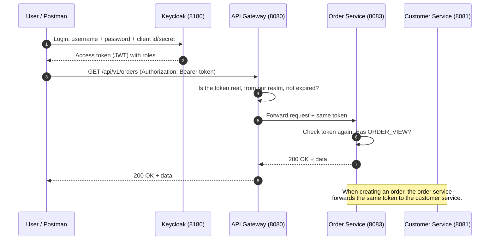

# OAuth 2.0 with Keycloak in a Spring Boot Microservice Project

A step-by-step guide for beginners. It explains **what** we do, **why** we do it, and **how** we do it in this project.

Every code sample comes from this repository, so you can open the real file and compare.

---

## Table of contents

1. [What problem are we solving?](#1-what-problem-are-we-solving)
2. [The words you must know](#2-the-words-you-must-know)
3. [The big picture](#3-the-big-picture)
4. [Before you start](#4-before-you-start)
5. [Part A: Set up Keycloak](#part-a-set-up-keycloak)
6. [Part B: Secure the Spring Boot services](#part-b-secure-the-spring-boot-services)
7. [Part C: Test everything](#part-c-test-everything)
8. [Troubleshooting](#troubleshooting)
9. [Why we made these choices](#why-we-made-these-choices)
10. [What to improve next](#what-to-improve-next)
11. [Cheat sheet: all files we touched](#cheat-sheet-all-files-we-touched)

---

## 1. What problem are we solving?

Without security, anyone who knows the URL `http://localhost:8080/api/v1/orders` can read, create or change orders.

We want three things:

| Question | Name | Example |
|---|---|---|
| **Who are you?** | Authentication | "I am `order.clerk`, and here is my password." |
| **What may you do?** | Authorization | "`order.clerk` may add and view orders, but may not delete customers." |
| **Can every service trust the answer?** | Token validation | Each service checks a signed proof instead of asking for the password again. |

**Why not build login ourselves?** Passwords, hashing, reset-password, login pages, brute-force protection and so on are easy to get wrong. A battle-tested login server called **Keycloak** does all of this. Our services only need to check "is this token real?".

---

## 2. The words you must know

| Word | Simple meaning | In this project |
|---|---|---|
| **OAuth 2.0** | A standard way to give an application permission **without sharing the password**. | The rules everyone follows. |
| **OpenID Connect (OIDC)** | OAuth 2.0 plus a standard way to say **who the user is**. | Keycloak speaks OIDC. |
| **Keycloak** | A server that stores users, checks passwords and **issues tokens**. | `http://localhost:8180` |
| **Realm** | A separate "world" inside Keycloak with its own users, roles and clients. | `Learn_Microservices` |
| **Client** | An application that is allowed to ask Keycloak for tokens (Postman, a website, a mobile app). | `learn-microservices-client` |
| **Role** | A permission label given to a user. | `ORDER_VIEW`, `ORDER_ADD` |
| **Token / JWT** | A small signed text that says "this is user X with roles Y, valid until time Z". JWT = *JSON Web Token*. | The `Authorization: Bearer <token>` header. |
| **Access token** | The JWT you send to the API. It lives a short time (minutes). | `access_token` in Keycloak's answer. |
| **Resource server** | An API that **only checks tokens** (it never logs anyone in). | Gateway, customer, product, order services. |
| **Issuer (`iss`)** | Who created the token. The service accepts only tokens from its own realm. | `http://localhost:8180/realms/Learn_Microservices` |
| **Authority** | Spring Security's word for a permission. We turn each Keycloak role into one authority. | `ORDER_VIEW` |
| **401 Unauthorized** | "I do not know who you are" (no token, bad token, expired token). | Missing or invalid token. |
| **403 Forbidden** | "I know who you are, but you may not do this." | Token is fine, role is missing. |

> **Remember:** 401 = *who are you?* and 403 = *you are not allowed*.

### What is inside a JWT?

A JWT has three parts separated by dots: `header.payload.signature`.

- The **payload** is plain JSON (only Base64 encoded, **not secret**). It looks like this (shortened):

```json
{
  "iss": "http://localhost:8180/realms/Learn_Microservices",
  "sub": "5f0c...-user-id",
  "preferred_username": "order.clerk",
  "exp": 1795419354,
  "realm_access": {
    "roles": ["ORDER_ADD", "ORDER_VIEW", "ORDER_EDIT", "CUSTOMER_VIEW", "PRODUCT_VIEW"]
  }
}
```

- The **signature** is made with Keycloak's **private key**. Anyone can check it with Keycloak's **public key**, but nobody can fake it. If a single character of the payload changes, the signature check fails.

That is why our services do not need to call Keycloak on every request. They download the public keys once, then check tokens by themselves.

---

## 3. The big picture

### The services in this project

| Service | Port | Job |
|---|---|---|
| Keycloak | 8180 | Login server. Issues tokens. |
| Config Server | 8888 | Gives settings to every service. |
| Discovery (Eureka) | 8761 | Phonebook of services. |
| **API Gateway** | **8080** | **The one front door.** First security check. |
| Customer service | 8081 | Customer data |
| Product service | 8082 | Products and categories |
| Order service | 8083 | Orders. Calls customer and product services. |

### The flow



### Two layers of security (defense in depth)

1. **Gateway**: "Is there a valid token?" If not, stop with 401. The request never reaches a service.
2. **Each service**: "Is the token valid **and** does the user have the right role?"

Why check twice? Because someone could call a service port directly (for example `localhost:8083`) and skip the gateway. **Every service must protect itself.**

### Where the roles are checked

Roles are checked **inside each service**, with `@PreAuthorize` on the controller methods. The gateway only checks "logged in or not".

---

## 4. Before you start

You need:

- Java 25, Maven (the project includes `mvnw`), PostgreSQL.
- Keycloak running on `http://localhost:8180`. Quick start with Docker (one example):

```bash
docker run -p 8180:8080 \
  -e KC_BOOTSTRAP_ADMIN_USERNAME=admin \
  -e KC_BOOTSTRAP_ADMIN_PASSWORD=admin \
  quay.io/keycloak/keycloak:latest start-dev
```

Open `http://localhost:8180` and log in to the admin console with `admin` / `admin` (local development only!).

**Start order for the project:** Keycloak, then Config Server, then Eureka (discovery), then customer, product and order services, then the gateway.

---

# Part A: Set up Keycloak

We create four things: a **realm**, **roles**, a **client**, and **users**.

## Step 1: Create the realm

**What:** a realm is a private space for this project's users and settings.
**Why:** do not use the `master` realm. It is for administrating Keycloak itself.

**How (UI):**
1. Open the admin console. Click the realm drop-down (top left, says `master`).
2. Click **Create realm**.
3. Realm name: `Learn_Microservices`. Enabled: on. Click **Create**.

Your realm's address (the **issuer**) is now:

```
http://localhost:8180/realms/Learn_Microservices
```

Open `http://localhost:8180/realms/Learn_Microservices/.well-known/openid-configuration` in a browser. It is a JSON page that lists every Keycloak address for this realm (token URL, public keys URL, and so on). Spring Security reads this page by itself.

## Step 2: Create the roles

**What:** a role is a permission name. We create `ADD`, `VIEW`, `EDIT`, `DELETE` for each of the three areas:

```
CUSTOMER_ADD  CUSTOMER_VIEW  CUSTOMER_EDIT  CUSTOMER_DELETE
PRODUCT_ADD   PRODUCT_VIEW   PRODUCT_EDIT   PRODUCT_DELETE
ORDER_ADD     ORDER_VIEW     ORDER_EDIT     ORDER_DELETE
```

**Why:** small, clear permissions let us give each user only what they need (*least privilege*).

**How (UI):** in realm `Learn_Microservices` go to **Realm roles** → **Create role** → type the name → **Save**. Repeat for all 12.

> We use **realm roles** (they belong to the whole realm). Keycloak also has *client roles*. Realm roles are simpler for a beginner project.

## Step 3: Create the client

**What:** a client is the application that is allowed to ask Keycloak for tokens.
**Why:** Keycloak never gives a token to an unknown application.

**How (UI):** **Clients** → **Create client**.

| Page | Field | Value |
|---|---|---|
| General settings | Client type | OpenID Connect |
| General settings | Client ID | `learn-microservices-client` |
| Capability config | Client authentication | **On** (this makes it a *confidential* client with a secret) |
| Capability config | Standard flow | On (browser login) |
| Capability config | Direct access grants | On (username + password, handy for Postman and tests) |
| Capability config | Service accounts roles | On (lets the client log in as itself) |
| Login settings | Valid redirect URIs | `http://localhost:8080/*` and `http://localhost:3000/*` |
| Login settings | Web origins | `+` |

Click **Save**. Then open the **Credentials** tab and copy the **Client secret**. You will need it for Postman.

> **Never commit the client secret to Git.** Treat it like a password.

## Step 4: Create users and give them roles

**What:** test users with different permissions.
**Why:** you can prove that security really works (the viewer is blocked, the admin is not).

| User | Roles |
|---|---|
| `admin.user` | all 12 roles |
| `order.clerk` | `ORDER_ADD`, `ORDER_VIEW`, `ORDER_EDIT`, `CUSTOMER_VIEW`, `PRODUCT_VIEW` |
| `viewer.user` | `CUSTOMER_VIEW`, `PRODUCT_VIEW`, `ORDER_VIEW` |

**How (UI):** **Users** → **Add user**.
1. Fill in username, **email**, **first name**, **last name**. Switch **Email verified** on. Click **Create**.
2. Tab **Credentials** → **Set password** → type a password → switch **Temporary** off → **Save**.
3. Tab **Role mapping** → **Assign role** → change the filter to **Filter by realm roles** → tick the roles → **Assign**.

> **Important:** if email, first name or last name is empty, Keycloak may answer *"Account is not fully set up"* when you try to log in with a password. Always fill them in.

<details>
<summary>Do the same with the Admin REST API (curl) instead of clicking</summary>

```bash
KC=http://localhost:8180

# 1) get an admin token from the master realm
TOKEN=$(curl -s -X POST $KC/realms/master/protocol/openid-connect/token \
  -d grant_type=password -d client_id=admin-cli \
  -d username=admin -d password=admin | sed -E 's/.*"access_token":"([^"]+)".*/\1/')
H="Authorization: Bearer $TOKEN"; J="Content-Type: application/json"

# 2) realm
curl -s -X POST $KC/admin/realms -H "$H" -H "$J" \
  -d '{"realm":"Learn_Microservices","enabled":true}'

# 3) one role (repeat for all 12)
curl -s -X POST $KC/admin/realms/Learn_Microservices/roles -H "$H" -H "$J" \
  -d '{"name":"ORDER_VIEW"}'

# 4) the client
curl -s -X POST $KC/admin/realms/Learn_Microservices/clients -H "$H" -H "$J" -d '{
  "clientId":"learn-microservices-client","enabled":true,"publicClient":false,
  "standardFlowEnabled":true,"directAccessGrantsEnabled":true,"serviceAccountsEnabled":true,
  "redirectUris":["http://localhost:8080/*","http://localhost:3000/*"],"webOrigins":["+"]}'

# 5) a user (then set roles in the UI or with the role-mappings endpoint)
curl -s -X POST $KC/admin/realms/Learn_Microservices/users -H "$H" -H "$J" -d '{
  "username":"viewer.user","enabled":true,"emailVerified":true,
  "firstName":"Viewer","lastName":"User","email":"viewer.user@example.com",
  "credentials":[{"type":"password","value":"password123","temporary":false}]}'
```

</details>

## Step 5: Get a token and look inside it

**What:** ask Keycloak for a token, exactly like an application would.
**Why:** if this works, Keycloak is set up correctly, and you will see the roles with your own eyes.

```bash
curl -s -X POST http://localhost:8180/realms/Learn_Microservices/protocol/openid-connect/token \
  -d grant_type=password \
  -d client_id=learn-microservices-client \
  -d client_secret=<YOUR_CLIENT_SECRET> \
  -d username=viewer.user \
  -d password=password123
```

The answer contains `access_token`, `expires_in` (seconds) and a `refresh_token`.

To read the payload on your own computer (the payload is not secret, but never paste real production tokens into websites):

```bash
echo "<ACCESS_TOKEN>" | cut -d. -f2 | tr '_-' '/+' | base64 -d
```

Look for `realm_access.roles`. **This list is what our Spring code will read.**

> **About the "password grant".** Sending username and password straight to the token endpoint is easy for learning and testing. For real web or mobile apps, use *Authorization Code + PKCE* (the user logs in on Keycloak's own page, and your app never sees the password).

---

# Part B: Secure the Spring Boot services

We repeat the same pattern in the **customer, product and order** services. The **gateway** gets a smaller version. Then the order service gets one extra class (token relay).

## Step 6: Add the dependencies

**What:** two Spring Boot starters. **Why:** the first brings Spring Security. The second brings the code that reads and checks JWT tokens.

Add to `pom.xml` of customer, product, order **and** api-gateway:

```xml
<dependency>
    <groupId>org.springframework.boot</groupId>
    <artifactId>spring-boot-starter-security</artifactId>
</dependency>
<dependency>
    <groupId>org.springframework.boot</groupId>
    <artifactId>spring-boot-starter-oauth2-resource-server</artifactId>
</dependency>

<!-- for tests -->
<dependency>
    <groupId>org.springframework.boot</groupId>
    <artifactId>spring-boot-starter-security-test</artifactId>
    <scope>test</scope>
</dependency>
```

> From this moment every endpoint is locked. Spring Security denies everything by default. The next steps open it correctly.

## Step 7: Tell the services where Keycloak is

**What:** one property, the **issuer URI**.
**Why:** with this address Spring downloads Keycloak's public keys and learns which `iss` value is allowed.

**Where:** `config-server/src/main/resources/configurations/application.properties`. This is the **shared** file. The Config Server sends it to **every** service, so we write the address **only once**.

```properties
spring.security.oauth2.resourceserver.jwt.issuer-uri=${KEYCLOAK_ISSUER_URI:http://localhost:8180/realms/Learn_Microservices}
```

- `${KEYCLOAK_ISSUER_URI:default}` means: use the environment variable if it exists, otherwise use the default. In Docker or production you only set the variable.
- Spring contacts Keycloak when the first token arrives, not at startup.
- The host in this URL must be **exactly** the host that appears in the token's `iss`. See [Troubleshooting](#troubleshooting).

> **Restart the Config Server** after changing this file. If a service starts without the property (Config Server not running), it fails to start, because it has no way to check tokens.

## Step 8: Write the security configuration

**What:** a `SecurityConfig` class. **Why:** it tells Spring Security: "every request needs a valid JWT; no sessions; read roles from the token".

`customer/src/main/java/com/customer/security/SecurityConfig.java` (same in product and order, only the package changes):

```java
@Configuration
@EnableWebSecurity
@EnableMethodSecurity          // turns on @PreAuthorize on controller methods
public class SecurityConfig {

    @Bean
    SecurityFilterChain securityFilterChain(HttpSecurity http, SecurityErrorHandler errorHandler) throws Exception {
        http
                .csrf(AbstractHttpConfigurer::disable)
                .sessionManagement(s -> s.sessionCreationPolicy(SessionCreationPolicy.STATELESS))
                .authorizeHttpRequests(auth -> auth.anyRequest().authenticated())
                .oauth2ResourceServer(oauth2 -> oauth2
                        .jwt(jwt -> jwt.jwtAuthenticationConverter(jwtAuthenticationConverter()))
                        .authenticationEntryPoint(errorHandler)     // 401 answer
                        .accessDeniedHandler(errorHandler));        // 403 answer
        return http.build();
    }

    private JwtAuthenticationConverter jwtAuthenticationConverter() {
        JwtAuthenticationConverter converter = new JwtAuthenticationConverter();
        converter.setJwtGrantedAuthoritiesConverter(new KeycloakRealmRoleConverter());
        return converter;
    }
}
```

Line by line:

| Line | Meaning |
|---|---|
| `csrf(disable)` | CSRF protects cookie-based browser sessions. We use tokens in a header, so it is not needed. |
| `STATELESS` | The server keeps no session. Every request must carry its own token. |
| `anyRequest().authenticated()` | Every URL needs a valid token. The **exact role** is checked later by `@PreAuthorize`. |
| `oauth2ResourceServer(... jwt ...)` | "I am a resource server. I check JWT tokens." |
| `authenticationEntryPoint` | What to send when there is **no or bad token** (401). |
| `accessDeniedHandler` | What to send when the token is fine but the **role is missing** (403). |

## Step 9: Turn Keycloak roles into Spring authorities

**What:** a small converter class. **Why:** Spring does not know that Keycloak hides the roles in `realm_access.roles`. This class reads them and creates one authority per role.

`KeycloakRealmRoleConverter.java`:

```java
public class KeycloakRealmRoleConverter implements Converter<Jwt, Collection<GrantedAuthority>> {

    @Override
    public Collection<GrantedAuthority> convert(Jwt jwt) {
        Map<String, Object> realmAccess = jwt.getClaimAsMap("realm_access");
        if (realmAccess == null || !(realmAccess.get("roles") instanceof Collection<?> roles)) {
            return List.of();
        }
        return roles.stream()
                .map(role -> (GrantedAuthority) new SimpleGrantedAuthority(String.valueOf(role)))
                .toList();
    }
}
```

We keep the names **exactly** as in Keycloak (`ORDER_VIEW`, with **no** `ROLE_` prefix). So later we check them with `hasAuthority('ORDER_VIEW')`.

## Step 10: Put the role names in one place

**What:** a `Permissions` class. **Why:** if you type `'ORDER_VEIW'` by mistake inside a string, nothing fails until a user is blocked at run time. With constants, a typo is a **compile error**.

`order/src/main/java/com/order/security/Permissions.java`:

```java
public final class Permissions {

    public static final String ORDER_ADD = "ORDER_ADD";
    public static final String ORDER_VIEW = "ORDER_VIEW";
    public static final String ORDER_EDIT = "ORDER_EDIT";
    public static final String ORDER_DELETE = "ORDER_DELETE";

    public static final String HAS_ORDER_ADD = "hasAuthority('" + ORDER_ADD + "')";
    public static final String HAS_ORDER_VIEW = "hasAuthority('" + ORDER_VIEW + "')";
    public static final String HAS_ORDER_EDIT = "hasAuthority('" + ORDER_EDIT + "')";
    public static final String HAS_ORDER_DELETE = "hasAuthority('" + ORDER_DELETE + "')";

    private Permissions() {
    }
}
```

The customer service has `CUSTOMER_*`, the product service has `PRODUCT_*` (products and categories share them).

## Step 11: Protect each endpoint with a role

**What:** one `@PreAuthorize` line above each controller method. **Why:** this is the actual authorization rule: "who may call this method".

`OrderController.java`:

```java
@PreAuthorize(Permissions.HAS_ORDER_ADD)
@PostMapping
public ResponseEntity<OrderResponse> create(@Valid @RequestBody OrderRequest request) { ... }

@PreAuthorize(Permissions.HAS_ORDER_VIEW)
@GetMapping("/{id}")
public OrderResponse getById(@PathVariable Long id) { ... }

@PreAuthorize(Permissions.HAS_ORDER_EDIT)
@PatchMapping("/{id}/status")
public OrderResponse updateStatus(...) { ... }
```

**The rule we used for every controller:**

| HTTP method | Role needed |
|---|---|
| `POST` (create) | `*_ADD` |
| `GET` (read) | `*_VIEW` |
| `PUT` / `PATCH` (change) | `*_EDIT` |
| `DELETE` | `*_DELETE` |

If the role is missing, Spring throws an `AccessDeniedException` and the answer is **403**.

## Step 12: Return clean JSON for 401 and 403

**What:** `SecurityErrorHandler` plus one extra handler in `GlobalExceptionHandler`.
**Why:** the default 401 has an **empty body**, and without a handler our `@ExceptionHandler(Exception.class)` would turn a 403 into a **500**. A client should get a clear message and the correct status.

`SecurityErrorHandler.java` (handles errors that happen in the **security filter**, before the controller):

```java
@Component
public class SecurityErrorHandler implements AuthenticationEntryPoint, AccessDeniedHandler {
    // commence(...) -> 401 + WWW-Authenticate header + JSON body
    // handle(...)   -> 403 + JSON body
}
```

`GlobalExceptionHandler.java` (handles the error thrown by `@PreAuthorize`, which happens **inside** the controller call):

```java
@ExceptionHandler(AccessDeniedException.class)
public ProblemDetail handleAccessDenied(AccessDeniedException ex) {
    ProblemDetail problem = ProblemDetail.forStatusAndDetail(
            HttpStatus.FORBIDDEN, "You do not have permission to perform this action");
    problem.setTitle("Forbidden");
    return problem;
}
```

Both answers look like:

```json
{ "type": "about:blank", "title": "Forbidden", "status": 403,
  "detail": "You do not have permission to perform this action" }
```

> **Why two places?** Spring Security has two "doors" where it can say no. One is the **filter chain** (before Spring MVC). The other is **method security** (inside the controller). Each door needs its own handler.

## Step 13: Secure the API Gateway

**What:** a smaller `SecurityConfig` in `api-gateway`. **Why:** the gateway should stop requests without a token before they reach any service.

```java
@Configuration
@EnableWebSecurity
public class SecurityConfig {

    @Bean
    SecurityFilterChain securityFilterChain(HttpSecurity http, SecurityErrorHandler errorHandler) throws Exception {
        http
                .csrf(AbstractHttpConfigurer::disable)
                .sessionManagement(s -> s.sessionCreationPolicy(SessionCreationPolicy.STATELESS))
                .authorizeHttpRequests(auth -> auth.anyRequest().authenticated())
                .oauth2ResourceServer(oauth2 -> oauth2
                        .jwt(Customizer.withDefaults())
                        .authenticationEntryPoint(errorHandler)
                        .accessDeniedHandler(errorHandler));
        return http.build();
    }
}
```

Differences from the services:
- **No `@EnableMethodSecurity`, no role converter.** The gateway does not check roles. Each service does.
- The gateway **forwards the `Authorization` header** to the service automatically. We wrote no code for that. The service then checks the token again.

## Step 14: Pass the token from the order service to other services

**What:** `BearerTokenRelayInterceptor` in the order service.
**Why:** when you create an order, the order service calls the customer service and the product service with **Feign**. Those services are protected too and would answer 401. This class copies the user's token into each Feign call, so those services see the same user.

`order/src/main/java/com/order/security/BearerTokenRelayInterceptor.java`:

```java
@Component
public class BearerTokenRelayInterceptor implements RequestInterceptor {

    @Override
    public void apply(RequestTemplate template) {
        Authentication authentication = SecurityContextHolder.getContext().getAuthentication();
        if (authentication instanceof AbstractOAuth2TokenAuthenticationToken<?> tokenAuthentication) {
            template.header(HttpHeaders.AUTHORIZATION, "Bearer " + tokenAuthentication.getToken().getTokenValue());
        }
    }
}
```

Spring Cloud OpenFeign automatically runs every `RequestInterceptor` bean before each Feign call. No other change is needed.

**Result:** the user who creates an order needs `ORDER_ADD` **and** `CUSTOMER_VIEW` **and** `PRODUCT_VIEW`, because the order service reads a customer and a product on the user's behalf. This is why `order.clerk` has those view roles.

---

# Part C: Test everything

## Step 15: Automatic tests (no Keycloak needed)

We wrote two kinds of tests in each service:

1. `KeycloakRealmRoleConverterTest` checks that `realm_access.roles` becomes authorities, and that a missing claim gives an empty list.
2. `<Name>ControllerSecurityTest` uses `@WebMvcTest` plus `jwt()` from `spring-security-test` to fake a logged-in user. It proves:
   - no token gives **401**
   - a token with the wrong role gives **403**
   - a token with `*_VIEW` can read (**200**)
   - `*_VIEW` alone cannot change data (**403**)

Run them:

```bash
cd java-services/order
./mvnw test -Dtest='*SecurityTest,KeycloakRealmRoleConverterTest'
```

## Step 16: Manual test with real tokens (curl)

Start Keycloak, the Config Server, Eureka, the services and the gateway. Then:

```bash
TOKEN=$(curl -s -X POST http://localhost:8180/realms/Learn_Microservices/protocol/openid-connect/token \
  -d grant_type=password -d client_id=learn-microservices-client \
  -d client_secret=<YOUR_CLIENT_SECRET> \
  -d username=viewer.user -d password=password123 \
  | sed -E 's/.*"access_token":"([^"]+)".*/\1/')

# no token -> 401
curl -i http://localhost:8080/api/v1/customers

# viewer reads customers -> 200
curl -i -H "Authorization: Bearer $TOKEN" http://localhost:8080/api/v1/customers

# viewer tries to delete -> 403
curl -i -X DELETE -H "Authorization: Bearer $TOKEN" http://localhost:8080/api/v1/customers/1
```

### What you should see

| Who | Request | Expected |
|---|---|---|
| nobody | `GET /api/v1/customers` | **401** |
| garbage token | `GET /api/v1/customers` | **401** |
| `viewer.user` | `GET /api/v1/customers` | **200** |
| `viewer.user` | `DELETE /api/v1/customers/1` | **403** |
| `viewer.user` | `POST /api/v1/orders` | **403** (no `ORDER_ADD`) |
| `order.clerk` | `POST /api/v1/orders` | **201** (has all roles it needs, including the two view roles) |
| `admin.user` | everything | allowed |

## Step 17: Test with Postman

1. Import `MicroService Keycloak.postman_collection.json`.
2. Open the collection variables and set **`clientSecret`** to the secret from Keycloak (Clients → `learn-microservices-client` → Credentials).
3. Run one request in the **auth (Keycloak)** folder (for example *Get Token - admin.user*). It saves the token in `{{accessToken}}`.
4. Every other request in the collection now sends `Authorization: Bearer {{accessToken}}` automatically.
5. Run *Gateway - No Token (401)* and *Gateway - Missing Role (403)* to see the failures on purpose. For the 403 one, first get a token for `viewer.user`.

> Tokens expire (a few minutes). If you suddenly get 401, run the login request again.

---

## Troubleshooting

| Symptom | Likely cause | Fix |
|---|---|---|
| **401** even with a fresh token | Token's `iss` does not match the `issuer-uri`. Very common: you got the token with `127.0.0.1` but the service uses `localhost` (or the other way round). | Use the **same host** in both places. Decode the token and compare `iss` with the property. |
| **401** after a few minutes | Token expired. | Get a new token. |
| 401 and the log says it cannot reach Keycloak | Keycloak is not running or the port is wrong. | Start Keycloak, check `http://localhost:8180/realms/Learn_Microservices`. |
| Service **fails at startup**: `No qualifying bean of type JwtDecoder` | The `issuer-uri` property was not loaded, usually because the **Config Server was not running** or was not restarted. | Start/restart the Config Server first. |
| **403** on a valid user | The role is missing in the token. | Decode the token and check `realm_access.roles`. Assign the role in Keycloak and **get a new token** (old tokens keep old roles). |
| Creating an order gives **503** "A required service is not available" | The order service's call to the customer/product service was rejected (the user has no `CUSTOMER_VIEW` or `PRODUCT_VIEW`), or those services are down. | Give the user the view roles and make sure both services run. |
| Keycloak login says **"Account is not fully set up"** | The user has no email, first name or last name. | Fill them in. |
| Keycloak says **"Invalid client credentials"** | Wrong `client_secret`. | Copy it again from the Credentials tab. |
| `@PreAuthorize` seems ignored | `@EnableMethodSecurity` is missing, or the method is called from another method of the same class. | Add the annotation to `SecurityConfig`. Put `@PreAuthorize` on controller methods. |

---

## Why we made these choices

**Why the service checks the token itself instead of asking Keycloak every time?**
The token is signed. Checking a signature is fast and needs no network call, so Keycloak is not a bottleneck.

**Why a gateway check and a service check?**
The gateway gives one clean place to reject anonymous traffic early. The service check protects the service if someone bypasses the gateway.

**Why `hasAuthority` and not `hasRole`?**
`hasRole('X')` adds a `ROLE_` prefix automatically. Our authorities have no prefix, so `hasAuthority('ORDER_VIEW')` says exactly what it means.

**Why realm roles and not client roles?**
They are simpler: one list per user. Client roles are better when many different applications need different permissions.

**Why stateless and no CSRF?**
The token is sent by our code in a header, never stored in a cookie, so a malicious website cannot make the browser send it by itself.

**Why is the Keycloak address in the Config Server and not in each service?**
One place to change. This is the same reason all services get the Eureka address from there.

---

## What to improve next

This is a solid learning setup. For production, also think about:

1. **A shared security library.** The security classes are copied into three services. A `common-security` Maven module removes the duplication.
2. **Keycloak configuration as code.** Keep a `realm-export.json` (or a Docker Compose realm import) in the repo so a new developer gets the same realm in one command.
3. **Audience validation.** Check the `aud` claim, so a token made for another client in the same realm is rejected.
4. **Service accounts for internal calls.** Today the order service reuses the user's token. Many teams use the *client credentials* flow so users do not need view roles for other services.
5. **Authorization Code + PKCE** for real frontends instead of the password grant.
6. **Secrets.** Keep the client secret and passwords in environment variables or a secret store, never in Git.
7. **Auditing.** Save who created or changed a record, using the `preferred_username` or `sub` claim.
8. **Secure the Config Server and Eureka** too.
9. **HTTPS** everywhere outside your laptop.

---

## Cheat sheet: all files we touched

| What | Where |
|---|---|
| Dependencies | `pom.xml` in customer, product, order, api-gateway |
| Keycloak address | `config-server/.../configurations/application.properties` |
| Security configuration | `<service>/src/main/java/.../security/SecurityConfig.java` |
| Role converter | `<service>/.../security/KeycloakRealmRoleConverter.java` (customer, product, order) |
| 401 / 403 JSON | `<service>/.../security/SecurityErrorHandler.java` |
| Role names | `<service>/.../security/Permissions.java` (customer, product, order) |
| Endpoint rules | `@PreAuthorize(...)` in each controller |
| 403 from `@PreAuthorize` | `AccessDeniedException` handler in each `GlobalExceptionHandler` |
| Token relay (Feign) | `order/.../security/BearerTokenRelayInterceptor.java` |
| Gateway guard | `api-gateway/.../security/SecurityConfig.java` |
| Tests | `<service>/src/test/java/.../security/` |
| Postman | `MicroService Keycloak.postman_collection.json` (auth folder, bearer token) |
